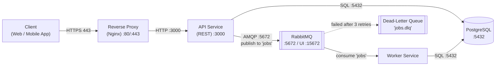

# Architecture Diagram

## Service Map



## Text Version (if Mermaid does not render)

```
                         ┌──────────────────────┐
  Client (Web/Mobile) ──►│ Reverse Proxy :443   │
                         └──────────┬───────────┘
                                    │ HTTP :3000
                         ┌──────────▼───────────┐   publish   ┌────────────────────┐
                         │     API Service      │────────────►│  RabbitMQ :5672    │
                         │       :3000          │   'jobs'    │  (UI :15672)       │
                         └──────────┬───────────┘             └───┬──────────┬─────┘
                                    │ SQL :5432          consume  │          │ after 3 failed
                         ┌──────────▼───────────┐       ┌─────────▼──────┐   ▼ retries
                         │   PostgreSQL :5432   │◄──────│ Worker Service │  'jobs.dlq'
                         └──────────────────────┘  SQL  └────────────────┘
```

## Ports and Services

| Service | Container | Internal port | Exposed to public? | Depends on |
|---|---|---|---|---|
| Reverse Proxy | `nginx` | 80 / 443 | ✅ Yes | api |
| API | `api` | 3000 | ❌ No (behind proxy) | postgres, rabbitmq |
| Worker | `worker` | — | ❌ No | postgres, rabbitmq |
| Database | `postgres` | 5432 | ❌ No | — |
| Message Queue | `rabbitmq` | 5672 (AMQP), 15672 (management UI) | ❌ No (UI internal only) | — |

## Data Flow — Example: Creating an Order

1. Client sends `POST /api/v1/orders` with a JWT token.
2. API validates the token and request body.
3. API writes the order to PostgreSQL with status `pending`.
4. API publishes a message `{ "orderId": 101, "type": "order.created" }` to the `jobs` queue.
5. API immediately returns `201 Created` to the client.
6. Worker consumes the message, processes it (e.g. sends notification, computes totals), and updates the order status to `processed` in PostgreSQL.
7. If processing fails 3 times, the message goes to the dead-letter queue `jobs.dlq` for manual review.

## Queue Topics

| Queue | Producer | Consumer | Message example |
|---|---|---|---|
| `jobs` | API | Worker | `{"orderId": 101, "type": "order.created"}` |
| `jobs.dlq` | RabbitMQ (auto) | Manual review | Failed messages after 3 retries |
